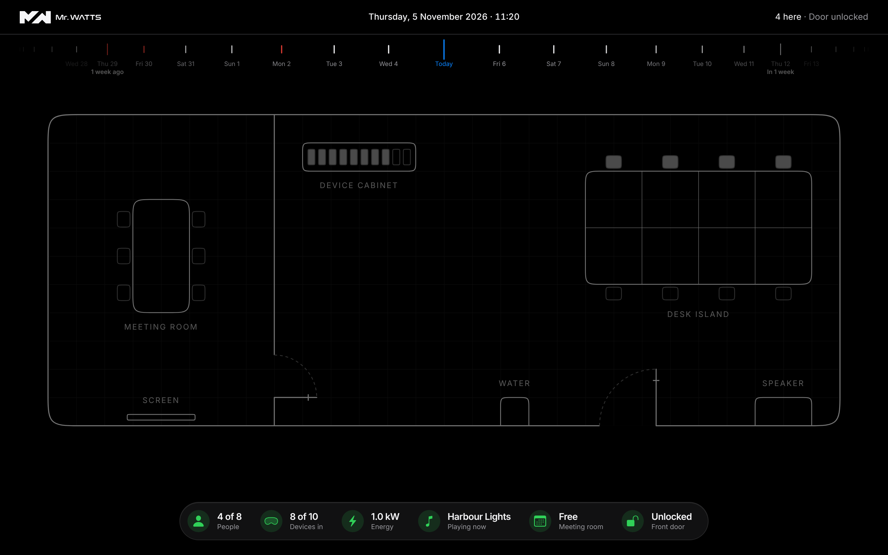
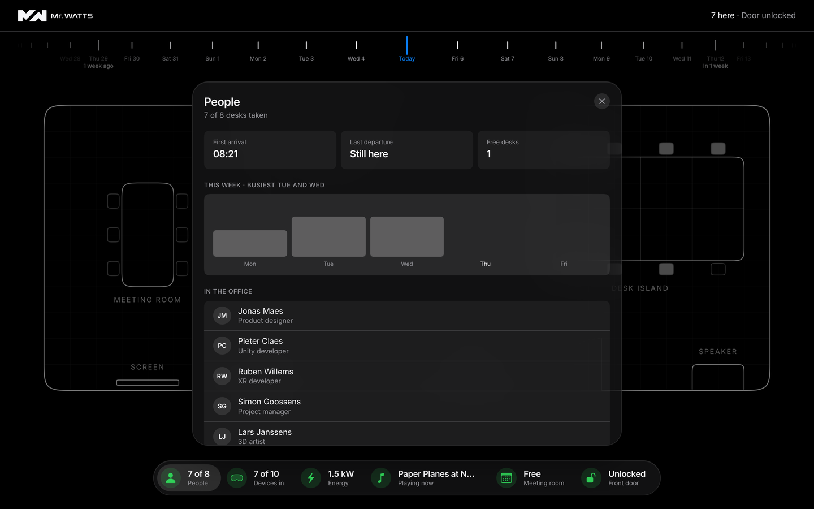

# Mr Watts Office Twin

A digital twin of the Mr Watts office, for the office manager. Scrub through time like a watch crown, from four weeks back to four weeks ahead. Built as an interview assignment for the UI/UX developer role.



## What it answers

| Brief | Where |
|---|---|
| Who is in now? | People pill, filled seats |
| How busy will it get? | Forecast from the last 4 weeks, drawn dashed |
| What music is playing? | Music pill: track, queue, played today |
| Which lights are on? | Energy sheet, per room |
| Which test devices are here? | Devices sheet: who has what, where, battery |
| Extras | Energy (derived from what's on) and the time machine |

Also: meeting room bookings, the front door, and water cups with CO₂ saved.

## Run

```bash
npm install
npm run dev     # npm run build · npm run lint
```

## Controls

| Input | Does |
|---|---|
| Drag, scroll or ← → | One day (10:00, or the hour you picked) |
| ⌘ ← → | One week |
| Hold the crown, or hold ↓ | Hour ticks |
| ↑ | Back to 10:00 |
| Space | Back to now |

Red ticks: door left unlocked. Yellow ticks: lights left on after hours. Click anything on the plan, or a pill, to open its sheet.



## How it works

`crown → moment → snapshotAt(moment) → every screen`

- **One snapshot** drives the header, plan, pills and sheets, so they never disagree.
- **Derived, not stored:** counts, energy and warnings are calculated in `data/derive.ts`.
- **No `null`:** unknown and expected are states the UI shows.
- **Forecast:** someone is expected if they were in at that time on at least 2 of the last 4 same weekdays. Backtested, it's off by 1.8 people a day. Devices use the same rule; energy is built from both.
- **Seeded history:** each day is generated from its date, so a moment always looks the same.
- **Solid = happened, dashed = expected**, everywhere.

## Structure

```
src/
  app/         shell, header, time machine
  model/       types
  data/        history (past), forecast (future), snapshot, derive
  features/    floor plan and sheets
  components/  ui and icons
```

## Decisions

- One persona, the office manager: who is in, never where they sit.
- Apple-inspired: dark, grid-aligned, squircles. Green good, yellow attention, red serious, grey off or unknown.
- Read-only: the twin shows the office; it doesn't control it.

## Not included

A backend with real sensors, GDPR for presence data, light mode, a full mobile layout.

## Stack

React 19, TypeScript, Tailwind CSS 4, Vite, oxlint. Frontend only, mocked data. SF Symbols are used for this prototype only; Apple's licence means a public release needs another icon set.
